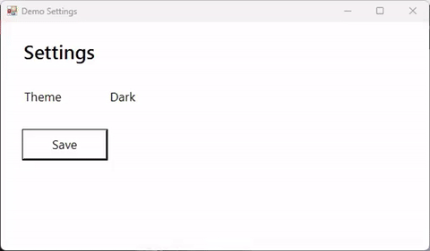

<div align="center">

# Screencast MCP

**An MCP server that lets an agent record the screen, _watch_ the footage, and make minimal ffmpeg edits — over stdio, on Windows.**

Capture the desktop, a monitor, a window, or a region; sample a recording into frames the agent can actually look at; trim, crop, redact, annotate, zoom toward clicks, and export for GitHub or social. No cloud service, no telemetry: ffmpeg and ffprobe behind <!--tool-count-->58<!--/tool-count--> typed tools.

**For developers who want their coding agent to see and prove UI changes on Windows**: bug repros, UI verification, and demo clips the agent records, checks, and edits itself. Capture is Windows-only; the watch and edit tools work on any OS with ffmpeg. Free for non-commercial use ([CC BY-NC-ND 4.0](#license)); [why not OBS, Playwright, or a screenshot MCP?](#why-not-just)

<br />

[](https://tmhsdigital.github.io/screencast-mcp/)

<br />

[](https://www.npmjs.com/package/@tmhs/screencast-mcp)
[](https://registry.modelcontextprotocol.io/v0/servers?search=screencast-mcp)
[](https://github.com/TMHSDigital/screencast-mcp/actions/workflows/ci.yml)
[](LICENSE)


<br />



<sub>Made with the tool: <code>start_recording</code> with <code>events: true</code>, one click, then <code>zoom { highlightClicks: true }</code> and <code>export_gif</code>. <a href="https://tmhsdigital.github.io/screencast-mcp/workflows/zoom-clicks.html">How it was made</a> · <a href="https://tmhsdigital.github.io/screencast-mcp/workflows/">more workflows</a></sub>

[Quick start](#quick-start) · [Tools](#tools) · [Configuration](#configuration) · [More docs](#more-docs) · [Privacy](#privacy)

</div>

## Quick start

The fastest path: `npx -y @tmhs/screencast-mcp setup` checks FFmpeg 8, OCR, and speech, offers `winget install Gyan.FFmpeg` when FFmpeg is missing, and adds the server to Claude Desktop, Claude Code, Cursor, and VS Code (backing up each config). `--dry-run` shows the changes first; `--test` records a 3-second GIF to prove it works. Or set it up by hand:

**You need** Windows 10 or 11, [Node.js](https://nodejs.org) 22+, and **FFmpeg 8 or newer** on `PATH` (`winget install Gyan.FFmpeg`, the full build). Older builds run most tools, but `transcribe` (the `whisper` filter) and `backend: "wgc"` (`gfxcapture`) need FFmpeg 8, and essentials or distro builds can lack them (Ubuntu LTS `apt install ffmpeg` gives 6.x). Capture is Windows-only; the watch, edit, and produce tools work anywhere ffmpeg runs. After connecting, ask the agent to run `doctor`: it reports the ffmpeg version, the filters and devices it has, OCR, and anything missing.

**Windows on ARM64** is in progress (#246): CI runs a non-blocking `windows-11-arm` job. gyan.dev ships no arm64 FFmpeg, so use BtbN's `winarm64-gpl` FFmpeg 8 build; it has `gdigrab`, `gfxcapture` and `drawtext` but no `whisper` or libvpx, so `transcribe` and `.webm` output need another build. `doctor` reports `arch` and what is missing.

**Add it to your client:**

| Client | How |
| --- | --- |
| Claude Code | `claude mcp add screencast -- cmd /c npx -y @tmhs/screencast-mcp`, or the plugin (the server plus bug-repro, README-demo, and UI-verify skills): `/plugin install screencast --marketplace TMHSDigital/screencast-mcp` (older Claude Code: `/plugin marketplace add TMHSDigital/screencast-mcp`, then `/plugin install screencast@screencast-mcp`) |
| Claude Desktop | Download [`screencast-mcp.mcpb`](https://github.com/TMHSDigital/screencast-mcp/releases/latest/download/screencast-mcp.mcpb) from the latest release and open it (one click) |
| Cursor, VS Code, others | The JSON config below, or step-by-step on [Connect your client](https://tmhsdigital.github.io/screencast-mcp/connect.html) |

```json
{ "mcpServers": { "screencast": { "command": "npx", "args": ["-y", "@tmhs/screencast-mcp"] } } }
```

**Then ask your agent:**

> Record my VS Code window for five seconds while I reproduce the bug, then show me the frames where something changed.

More in the [workflows](https://tmhsdigital.github.io/screencast-mcp/workflows/): a bug-repro GIF for a PR, a README demo, a UI verification loop, a social clip, a cheap review of a long recording, zoom toward clicks, and the whole edit in one call.

## Why not just...

The core is the **watch loop**: the agent records, samples the footage into frames it can see, and checks what actually happened on screen. Capture only ever happens on an explicit tool call, and output lands under `SCREENCAST_HOME`, never in your checkout.

| Instead of | The difference |
| --- | --- |
| OBS, ShareX, Game Bar | Built for a person at the controls. Here the agent starts and stops the recording, looks at the frames, and makes the edits through typed tools, with no GUI step. |
| Playwright or Puppeteer video | Browser pages only, and the video is a file the model never sees. Here: any window or monitor, frames returned to the model, plus `wait_for_change`, `find_text`, and `screen_diff` for checking what happened. |
| A screenshot-only MCP server | Single stills. Here: video over time, an input event log, scene-change sampling, redaction, and export, so the agent can show a sequence, not one moment. |

## Tools

<!-- tools:start -->
58 tools in 6 toolsets, generated from the server's own schemas by `npm run docs` (do not edit between the markers). Each name links to its reference page with every parameter, an example call, and what it returns; [`mcp-tools.json`](mcp-tools.json) is the same list as JSON, and [`llms-full.txt`](https://tmhsdigital.github.io/screencast-mcp/llms-full.txt) all of it in one file.

### Core

Always loaded, whatever `SCREENCAST_TOOLSETS` selects.

| Tool | What it does |
| --- | --- |
| [`get_media_info`](https://tmhsdigital.github.io/screencast-mcp/tools/get_media_info.html) | Probe a media file with ffprobe and return duration, resolution, frame rate, codecs, container format, and size. |
| [`doctor`](https://tmhsdigital.github.io/screencast-mcp/tools/doctor.html) | Check the setup: ffmpeg/ffprobe (FFmpeg 8+?), optional filters, capture devices, Windows OCR, settings, and enabled toolsets; `problems` says what is missing and how to fix it. Call on first use or when a tool reports a missing feature. |

### Capture

Record or screenshot the desktop, a monitor, a window, or a region. Every capture is an explicit tool call: nothing records on its own.

| Tool | What it does |
| --- | --- |
| [`start_recording`](https://tmhsdigital.github.io/screencast-mcp/tools/start_recording.html) | Start a background screen recording. Returns a session id; finalize it with stop_recording. Never auto-starts. |
| [`stop_recording`](https://tmhsdigital.github.io/screencast-mcp/tools/stop_recording.html) | Stop a recording gracefully so the file is finalized; returns the path and duration. |
| [`pause_recording`](https://tmhsdigital.github.io/screencast-mcp/tools/pause_recording.html) | Pause a recording; until resume_recording nothing is captured, and the gap is left out of the file, events, and markers. |
| [`resume_recording`](https://tmhsdigital.github.io/screencast-mcp/tools/resume_recording.html) | Resume a paused recording (same target and settings). |
| [`save_replay`](https://tmhsdigital.github.io/screencast-mcp/tools/save_replay.html) | Save the last N seconds of a replay buffer (start_recording replayBufferSec) to an mp4; the buffer keeps running. |
| [`list_sessions`](https://tmhsdigital.github.io/screencast-mcp/tools/list_sessions.html) | List all recording sessions (active and finished) with their status, target, output path, and whether the process is still alive. |
| [`get_session`](https://tmhsdigital.github.io/screencast-mcp/tools/get_session.html) | Inspect a single recording session by id, including live status and whether its output file exists on disk. |
| [`read_events`](https://tmhsdigital.github.io/screencast-mcp/tools/read_events.html) | Read the input events (clicks, scroll, cursor, shortcuts, typing bursts) of a recording made with events: true, in video seconds and pixels; e.g. types: ['down'], then sample_frames there. |
| [`add_marker`](https://tmhsdigital.github.io/screencast-mcp/tools/add_marker.html) | Mark a labelled moment on a recording, live or at a second. Kept in the session and a sidecar; chapters and pipeline turn markers into chapters. |
| [`screenshot`](https://tmhsdigital.github.io/screencast-mcp/tools/screenshot.html) | Capture one PNG of the screen, a monitor, a window, or a region, returned inline and by path. |
| [`list_audio_devices`](https://tmhsdigital.github.io/screencast-mcp/tools/list_audio_devices.html) | List DirectShow audio devices and flag a likely loopback (Stereo Mix or a virtual-audio driver), for start_recording's audio.device. |
| [`list_video_devices`](https://tmhsdigital.github.io/screencast-mcp/tools/list_video_devices.html) | List DirectShow cameras for start_recording's webcam.device. |
| [`list_targets`](https://tmhsdigital.github.io/screencast-mcp/tools/list_targets.html) | List the desktop, monitors, and visible windows (topmost first, with capturability per backend). Each entry has a `target` string to pass as-is to capture tools; use it instead of guessing a title. |

### Watch

Turn footage into something a model can read: frames, contact sheets, diffs, OCR, and a searchable text timeline.

| Tool | What it does |
| --- | --- |
| [`review_recording`](https://tmhsdigital.github.io/screencast-mcp/tools/review_recording.html) | Open a recording for a person to review: in MCP Apps clients an inline player to scrub, trim, and redact, then export; elsewhere just the video's details. |
| [`player_frames`](https://tmhsdigital.github.io/screencast-mcp/tools/player_frames.html) | Preview frames for the review player: JPEGs on an even grid over the video plus frames at scene changes, with their real times. Used by the inline player; agents should use sample_frames or contact_sheet instead. *(app-only: called by the review player, not the agent)* |
| [`sample_frames`](https://tmhsdigital.github.io/screencast-mcp/tools/sample_frames.html) | Sample PNG frames from a video (by fps, timestamps, or scene changes) and return the first few inline so the model can see what happened. |
| [`contact_sheet`](https://tmhsdigital.github.io/screencast-mcp/tools/contact_sheet.html) | Tile timestamped frames of a video into one image to see a whole recording at a glance (the cheapest first look). |
| [`screen_diff`](https://tmhsdigital.github.io/screencast-mcp/tools/screen_diff.html) | Compare two screenshots or frames: SSIM score, changed share, and changed boxes in b's pixels, to check a UI change happened only where expected. |
| [`wait_for_change`](https://tmhsdigital.github.io/screencast-mcp/tools/wait_for_change.html) | Wait until part of the screen changes or settles, instead of guessing a sleep. Returns the elapsed time, changed regions (screenshot pixels; add `origin` for desktop), and the final state. |
| [`find_text`](https://tmhsdigital.github.io/screencast-mcp/tools/find_text.html) | OCR (built into Windows) on the screen, an image, or video frames, with line and match boxes in image pixels (add `origin` for desktop coordinates). Locate UI text or secrets (e.g. regex 'sk-\|ghp_\|api.?key') to redact. Best-effort: review results. |
| [`index_recording`](https://tmhsdigital.github.io/screencast-mcp/tools/index_recording.html) | Build a recording's text timeline (<video>.index.json: OCR per scene, events, markers, transcript) for search_recording. |
| [`search_recording`](https://tmhsdigital.github.io/screencast-mcp/tools/search_recording.html) | Search an index_recording timeline (screen text, events, markers, transcript): timecoded hits, best first, secrets masked. No frames unless asked. |

### Edit

Cut, convert, compress, and redact. A tool that writes a file refuses to replace an existing `output` unless `overwrite: true`; default output paths are always unique.

| Tool | What it does |
| --- | --- |
| [`trim`](https://tmhsdigital.github.io/screencast-mcp/tools/trim.html) | Cut a video down to one sub-clip by start + (end or duration). For several segments use clip; to combine with other edits use pipeline. |
| [`concat`](https://tmhsdigital.github.io/screencast-mcp/tools/concat.html) | Join videos end to end with hard cuts: stream copy when they match, else a re-encode (`mode` says which). For transitions use xfade_transition or assemble_highlights. |
| [`convert`](https://tmhsdigital.github.io/screencast-mcp/tools/convert.html) | Convert media to mp4, webm, or gif. For a size-bounded GIF/WebP prefer export_gif; for a smaller mp4, compress or export_preset. |
| [`export_gif`](https://tmhsdigital.github.io/screencast-mcp/tools/export_gif.html) | Export an animated GIF or WebP that fits a size budget (for PRs, issues, READMEs), stepping fps, width, and quality down until it fits. |
| [`crop`](https://tmhsdigital.github.io/screencast-mcp/tools/crop.html) | Crop a video to a pixel rectangle; one running off the frame is rejected. |
| [`scale`](https://tmhsdigital.github.io/screencast-mcp/tools/scale.html) | Resize a video to a target width and/or height and re-encode. Provide one side to keep the aspect ratio, or both to set an exact size. |
| [`speed`](https://tmhsdigital.github.io/screencast-mcp/tools/speed.html) | Change playback speed by a factor (>1 faster, <1 slower) and re-encode. Audio is retempo'd to match when the source has an audio track. |
| [`compress`](https://tmhsdigital.github.io/screencast-mcp/tools/compress.html) | Re-encode a video smaller (H.264 CRF ladder, optional width cap). For a platform target use export_preset. |
| [`clip`](https://tmhsdigital.github.io/screencast-mcp/tools/clip.html) | Extract several frame-exact segments, each to its own file. For one segment, trim does the same. |
| [`cut_idle`](https://tmhsdigital.github.io/screencast-mcp/tools/cut_idle.html) | Remove dead air: cut stretches where the screen is frozen (and silent), keeping a short pad. Returns the time saved. |
| [`cut_by_transcript`](https://tmhsdigital.github.io/screencast-mcp/tools/cut_by_transcript.html) | Edit a video by its transcript: cut quoted text, cue numbers, or fillers. Also writes the re-timed .srt. |
| [`redact_region`](https://tmhsdigital.github.io/screencast-mcp/tools/redact_region.html) | Cover given rectangles in a video (e.g. secrets on screen). Not automatic detection: find them with find_text redact: true. Off-frame regions are rejected. |
| [`pipeline`](https://tmhsdigital.github.io/screencast-mcp/tools/pipeline.html) | Run several edits (trim, crop, scale, speed, cut_idle, redact, callout, keystroke_overlay, cursor, reframe, zoom, backdrop, audio, burn_subtitles, then optionally export_preset or export_gif) in one ffmpeg pass: one re-encode, no intermediate files. Prefer it over chaining edit tools; a recipe does the usual polish in one call. |

### Produce

Annotate, frame, and assemble a finished piece. Tools that combine clips normalize each input to a common resolution, fps, and audio rate first.

| Tool | What it does |
| --- | --- |
| [`overlay`](https://tmhsdigital.github.io/screencast-mcp/tools/overlay.html) | Composite an image or video (logo, watermark, picture-in-picture) onto a video at a pixel position, optionally scaled and time-limited; keeps the base's audio and length. |
| [`callout`](https://tmhsdigital.github.io/screencast-mcp/tools/callout.html) | Annotate a video with timed boxes, text labels, and arrows. Fallback fonts used are listed in fallbackFonts; characters no font covers are reported in warnings. |
| [`keystroke_overlay`](https://tmhsdigital.github.io/screencast-mcp/tools/keystroke_overlay.html) | Burn keycast-style badges for shortcuts, clicks, and typing from the recording's input event log (start_recording events: true). Never shows typed text: the log has none. |
| [`cursor`](https://tmhsdigital.github.io/screencast-mcp/tools/cursor.html) | Draw a smoothed, scaled cursor that hides when idle from the event log of a start_recording cursor: "events" recording (no OS cursor in the video), with click ripples and an optional spotlight. |
| [`backdrop`](https://tmhsdigital.github.io/screencast-mcp/tools/backdrop.html) | Frame a video or screenshot on a gradient, color, or wallpaper with padding, rounded corners, and a drop shadow, optionally on a 16:9/1:1/9:16/4:5 canvas. |
| [`burn_subtitles`](https://tmhsdigital.github.io/screencast-mcp/tools/burn_subtitles.html) | Burn SRT/ASS subtitles (e.g. from transcribe) into a video in the bundled font. |
| [`chapters`](https://tmhsdigital.github.io/screencast-mcp/tools/chapters.html) | Write chapters (markers, scene changes, transcript, or a list) into an mp4/mkv/mov copy without re-encoding; returns YouTube chapter text. Can mux an SRT as soft subtitles. |
| [`xfade_transition`](https://tmhsdigital.github.io/screencast-mcp/tools/xfade_transition.html) | Join two videos with an xfade transition (audio crossfaded); they need not match in size, fps, or audio. For more clips use assemble_highlights. |
| [`assemble_highlights`](https://tmhsdigital.github.io/screencast-mcp/tools/assemble_highlights.html) | Stitch clips (including title cards) into one video with cuts or xfade transitions; they need not match in size, fps, or audio. |
| [`title_card`](https://tmhsdigital.github.io/screencast-mcp/tools/title_card.html) | Generate a title card clip (centered text on a solid background, silent audio track) to stitch in with assemble_highlights. Uncoverable characters are reported in warnings. |
| [`reframe`](https://tmhsdigital.github.io/screencast-mcp/tools/reframe.html) | Re-aspect a video to 16:9, 9:16, 1:1, or 4:5 by padding or cropping. |
| [`zoom`](https://tmhsdigital.github.io/screencast-mcp/tools/zoom.html) | Smooth animated zoom-and-pan into the action and back out, from keyframes or planned from logged clicks or screen changes. |
| [`export_preset`](https://tmhsdigital.github.io/screencast-mcp/tools/export_preset.html) | Encode a platform-ready H.264 file (aspect, fps, bitrate, faststart) for a named platform. |
| [`bug_report`](https://tmhsdigital.github.io/screencast-mcp/tools/bug_report.html) | Package a recording as a paste-ready repro folder: secret-scanned, redacted clip and GIF, contact sheet, steps from the event log, OCR'd errors, environment, report.md for gh issue create --body-file. |
| [`step_guide`](https://tmhsdigital.github.io/screencast-mcp/tools/step_guide.html) | Turn a recording's event log into a numbered how-to: a ringed screenshot and caption per step, marker headings; Markdown and/or one HTML file. Never includes typed text. |

### Audio

Extract, clean up, level, transcribe, and score the soundtrack.

| Tool | What it does |
| --- | --- |
| [`extract_audio`](https://tmhsdigital.github.io/screencast-mcp/tools/extract_audio.html) | Extract the audio track of a media file to its own file (mp3, aac, wav, or copy). Returns the output path. |
| [`normalize_audio`](https://tmhsdigital.github.io/screencast-mcp/tools/normalize_audio.html) | Normalize loudness to a delivery target (two-pass EBU R128 loudnorm); video is copied. Reports loudness before and after. |
| [`denoise`](https://tmhsdigital.github.io/screencast-mcp/tools/denoise.html) | Reduce steady background noise (fan, hum, hiss) in a recording's audio with an adaptive FFT denoiser. Video is copied untouched. Returns the output path. |
| [`transcribe`](https://tmhsdigital.github.io/screencast-mcp/tools/transcribe.html) | Transcribe a recording's speech to an SRT subtitle file, locally, with FFmpeg 8's whisper filter (needs a whisper.cpp model file). Returns the SRT path and the text. Pair with burn_subtitles to caption the video. |
| [`music_bed`](https://tmhsdigital.github.io/screencast-mcp/tools/music_bed.html) | Lay music under a video: looped or trimmed to length, faded, leveled, and mixed with any existing audio. Video is stream-copied. |
| [`narrate`](https://tmhsdigital.github.io/screencast-mcp/tools/narrate.html) | Offline voiceover with the built-in Windows voices: speaks each line at its time or marker over the audio, plus an SRT. |
<!-- tools:end -->

> [!IMPORTANT]
> `redact_region` covers only the rectangles **you** declare; it is not automatic secret detection (use `find_text` with `redact: true` to locate them). Prefer the default `box` style for real secrets: it is a solid, irreversible fill, while `blur` and `pixelate` can be partially recovered.

Every capture tool takes one `target` string: `full`, `monitor:<index>`, `window:<title>`, `window:exe=<app.exe>`, `window:hwnd=<handle>`, or `region:<x>,<y>,<w>,<h>`; `list_targets` returns ready-made ones. See [`start_recording`](https://tmhsdigital.github.io/screencast-mcp/tools/start_recording.html) and the [Windows notes](https://tmhsdigital.github.io/screencast-mcp/#windows-notes) for how windows, monitors, and `backend: "wgc"` are captured.

## Configuration

`ffmpeg` and `ffprobe` must be on `PATH`, or set `FFMPEG_PATH` / `FFPROBE_PATH`. All settings are optional environment variables; `doctor` reports the ones in effect.

| Variable | Default | Purpose |
| --- | --- | --- |
| `SCREENCAST_HOME` | `<homedir>/.screencast-mcp` | Where recordings, frames, screenshots, and edits are written |
| `SCREENCAST_ALLOWED_DIRS` | none | `;`-separated folders tools may also read from and write to; when set, or when the client sends roots, files outside `SCREENCAST_HOME`, the roots, and these folders are refused. Without either, replacing an existing file outside `SCREENCAST_HOME` is refused. Network (UNC) paths are always refused |
| `SCREENCAST_MAX_RECORDING_SEC` | `3600` | Default recording cap (`0` disables it) |
| `SCREENCAST_JOB_TIMEOUT_MS` | scales with length | Override the edit job timeout |
| `SCREENCAST_WHISPER_MODEL` | none | whisper.cpp model for `transcribe` |
| `SCREENCAST_RETENTION_DAYS` | off | Delete screenshots, frames, leftover raw event logs, and `index_recording` indexes older than this many days at startup (never recordings or edits; an index is rebuilt by running `index_recording` again) |
| `SCREENCAST_PS_TIMEOUT_MS` | 20000 (OCR 60000) | Limit for the PowerShell helpers that list monitors and windows and run OCR |
| `SCREENCAST_CONFIRM_CAPTURE` | off | Set to `1` to ask the user to confirm every live capture through MCP elicitation; clients without elicitation are refused |
| `SCREENCAST_TOOLSETS` | `all` | Comma-separated toolsets to expose; the rest are not loaded, which shrinks the tool list the agent pays for on every turn (`core` is always on) |
| `FFMPEG_PATH` / `FFPROBE_PATH` | `PATH` lookup | Explicit ffmpeg / ffprobe binaries |

<!-- toolsets:start -->
| Toolset | Tools |
| --- | --- |
| `capture` | `start_recording`, `stop_recording`, `pause_recording`, `resume_recording`, `save_replay`, `list_sessions`, `get_session`, `read_events`, `add_marker`, `screenshot`, `list_audio_devices`, `list_video_devices`, `list_targets` |
| `watch` | `review_recording`, `player_frames`, `sample_frames`, `contact_sheet`, `screen_diff`, `wait_for_change`, `find_text`, `index_recording`, `search_recording` |
| `edit` | `trim`, `concat`, `convert`, `export_gif`, `crop`, `scale`, `speed`, `compress`, `clip`, `cut_idle`, `cut_by_transcript`, `redact_region`, `pipeline` |
| `produce` | `overlay`, `callout`, `keystroke_overlay`, `cursor`, `backdrop`, `burn_subtitles`, `chapters`, `xfade_transition`, `assemble_highlights`, `title_card`, `reframe`, `zoom`, `export_preset`, `bug_report`, `step_guide` |
| `audio` | `extract_audio`, `normalize_audio`, `denoise`, `transcribe`, `music_bed`, `narrate` |
| `core` (always) | `get_media_info`, `doctor` |
<!-- toolsets:end -->

## More docs

- **Usage:** [workflows](https://tmhsdigital.github.io/screencast-mcp/workflows/) walk through real tool calls and outputs: a bug-repro clip, a README demo, a UI verification loop, a social clip, a long-recording review, zoom toward clicks, and the whole edit in one `pipeline` call. Each tool's parameters and results are on its [reference page](https://tmhsdigital.github.io/screencast-mcp/tools/).
- **Command line and CI:** the same package is a headless CLI (`npx -y @tmhs/screencast-mcp record -- npm run test:e2e`, `... call doctor`), and a GitHub Action records your test run on `windows-latest` and uploads the evidence on failure (being published to GitHub Marketplace). See the [CI page](https://tmhsdigital.github.io/screencast-mcp/ci.html):

  ```yaml
  - uses: TMHSDigital/screencast-mcp@v0
    with:
      command: npm run test:e2e
  ```
- **Prompts and resources:** the server also ships MCP prompts that clients show as slash commands (`bug-repro-clip`, `file-bug-report`, `document-steps`, `demo-gif`, `verify-ui-change`, `review-recording`) and `screencast://sessions` resources for attaching recordings without a filesystem tool. A client can subscribe to the list or one session and is notified when it changes, such as a recording that stopped at its cap.
- **Threat model and Windows notes:** what capture can expose, and how window, monitor, WGC, and system-audio capture behave, are on the [docs home page](https://tmhsdigital.github.io/screencast-mcp/#threat-model).

## Privacy

- **No network requests, no telemetry.** The server runs ffmpeg, ffprobe, and PowerShell locally and talks to your client over stdio. OCR (`find_text`) and speech (`narrate`) use the engines built into Windows.
- **What a tool returns goes to your model provider.** Inline frames, OCR text, and event summaries reach your agent like any tool result; files on disk stay on disk unless a tool returns them or you share them.
- **Everything is stored under `SCREENCAST_HOME`** (`recordings/`, `screenshots/`, `frames/`, `edits/`, `sessions.json`) unless a call names another path. `find_text` and `wait_for_change` delete their captures after the call by default (`keep: true` keeps them); `screen_diff` compares existing images and captures nothing.
- **The event log never records typed text.** Only with `start_recording` `events: true` (or `cursor: "events"`), and only while that recording runs: clicks, scrolls, and cursor positions system-wide, and typing as bursts on a 0.5 s grid with no key names (`keys: "shortcuts"` also names Ctrl/Alt/Win chords). There is no microphone capture; system audio only with `audio.source` = `system`.
- **Deleting data.** Delete files under `SCREENCAST_HOME`, or set `SCREENCAST_RETENTION_DAYS`; recordings and edits are never deleted automatically.

## Contributing

Issues and pull requests are welcome — see [CONTRIBUTING.md](CONTRIBUTING.md) (development setup and project structure) and the [Code of Conduct](CODE_OF_CONDUCT.md). Security reports go through [SECURITY.md](SECURITY.md).

## License

Released under the [CC-BY-NC-ND-4.0](LICENSE) license: free to use and share for non-commercial purposes, with attribution and without modification. For other uses, [open an issue](https://github.com/TMHSDigital/screencast-mcp/issues).

**Can I use it at work?** Only for non-commercial purposes under this license. If your use is commercial (inside a paid product or service, or work done mainly for commercial advantage), or you are not sure, [open an issue](https://github.com/TMHSDigital/screencast-mcp/issues) to ask about a commercial license. The licensing model is described in the [TMHSDigital licensing standard](https://github.com/TMHSDigital/Developer-Tools-Directory/blob/main/standards/licensing.md).

<div align="center">
<br />

[**Documentation**](https://tmhsdigital.github.io/screencast-mcp/) · [**Roadmap**](ROADMAP.md) · [**Report an issue**](https://github.com/TMHSDigital/screencast-mcp/issues) · [**License**](LICENSE)

<sub>Built by <a href="https://github.com/TMHSDigital">TMHSDigital</a> · <a href="#screencast-mcp">Back to top ↑</a></sub>

</div>
